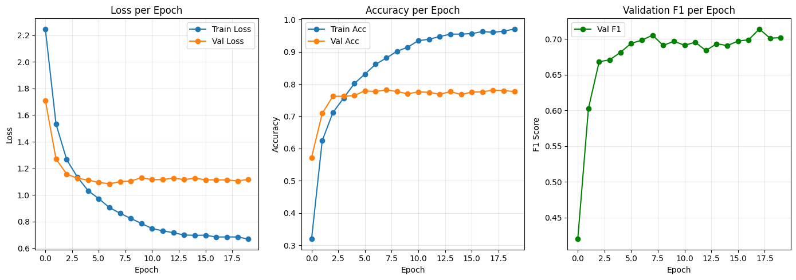
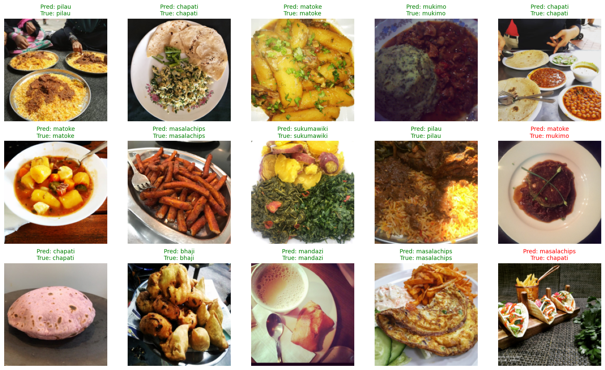

# Kenyan Food Classifier 🍛

This is my first deep learning project where I trained a model to look at a photo of food and tell me which Kenyan dish it is. There are 13 dishes, like chapati, ugali, pilau, mandazi and matoke.

I built it for a Kaggle competition and used a pretrained model (ResNet50) instead of training from scratch.

**My Kaggle notebook:** https://www.kaggle.com/code/yashasiv/project2-kaggle-competition-classification-round4

## How well does it work?

| What I measured | Score |
|---|---|
| Accuracy on my validation set | about 78% |
| F1 score on my validation set | about 0.70 |
| Accuracy on Kaggle's test set | about 75% |

So it gets roughly 3 out of 4 photos right.

## Training graphs



These graphs taught me the most. The blue line (training accuracy) keeps going up to about 97%, but the orange line (validation accuracy) stops at around 78%. That means the model is partly memorizing the training photos instead of really learning what the food looks like. This is called overfitting.

## Some predictions

Green means the model was right and red means it was wrong.



It gets most of them right. The mistakes are on tricky photos. For example, one photo of tacos was labeled "chapati" in the data, and my model guessed "masalachips".

## The 13 dishes

bhaji, chapati, githeri, kachumbari, kukuchoma, mandazi, masalachips, matoke, mukimo, nyamachoma, pilau, sukumawiki, ugali

## What I did, step by step

1. **Loaded the data.** I wrote my own PyTorch Dataset. The competition only gives one training file, so I split it myself: 80% for training and 20% for checking the model.
2. **Prepared the images.** I resized them all to 224x224 and normalized them the way ResNet50 expects.
3. **Added augmentation.** I randomly flipped, rotated, and changed the colors of the training photos so the model sees a slightly different version every time. This helps it not memorize.
4. **Built the model.** I started from ResNet50 (already trained on ImageNet), froze the early layers, and trained only the last two blocks (`layer3` and `layer4`) plus a new final layer for my 13 classes. I added dropout to fight overfitting.
5. **Trained it.** I used the Adam optimizer, label smoothing, weight decay, a learning rate scheduler, and early stopping. Training took about 25 minutes on a Kaggle GPU.
6. **Measured it.** I tracked accuracy and F1 score. I used F1 because some foods have more photos than others, and accuracy alone can hide that.
7. **Logged everything** to TensorBoard so I could see the graphs.

## What I learned

- My first try got about 99% on training data but only 76% on validation. That was my first real look at overfitting.
- Dropout, weight decay, label smoothing and more augmentation helped. My Kaggle score went from 72% to 75%.
- Training more layers with a smaller learning rate worked better than I expected.
- F1 (0.70) is lower than accuracy (78%), so some dishes are harder for the model than others.

**Things I want to try next:** test-time augmentation, bigger images, and combining two models.

## What's in this repo

```
├── kenyan_food_classification_notebook.ipynb   <- all my code and outputs
├── assets/                                     <- the pictures used in this README
├── logs/FT-LOGS-KenyanFood13/                  <- TensorBoard logs
├── outputs/submission.csv                      <- the file I submitted to Kaggle
├── requirements.txt                            <- libraries needed
└── README.md
```

## If you want to run it yourself

1. Download the data from the Kaggle competition called *OpenCV PyTorch Project-2 Classification - Round 4*.
2. Install the libraries:
   ```bash
   pip install -r requirements.txt
   ```
3. Open the notebook and change `DATA_ROOT` (in `DatasetConfig`) to where your data is.
4. Run all the cells.

To look at my training logs:
```bash
tensorboard --logdir logs/FT-LOGS-KenyanFood13
```

## Tools I used

Python, PyTorch, torchvision, scikit-learn, pandas, matplotlib, TensorBoard
